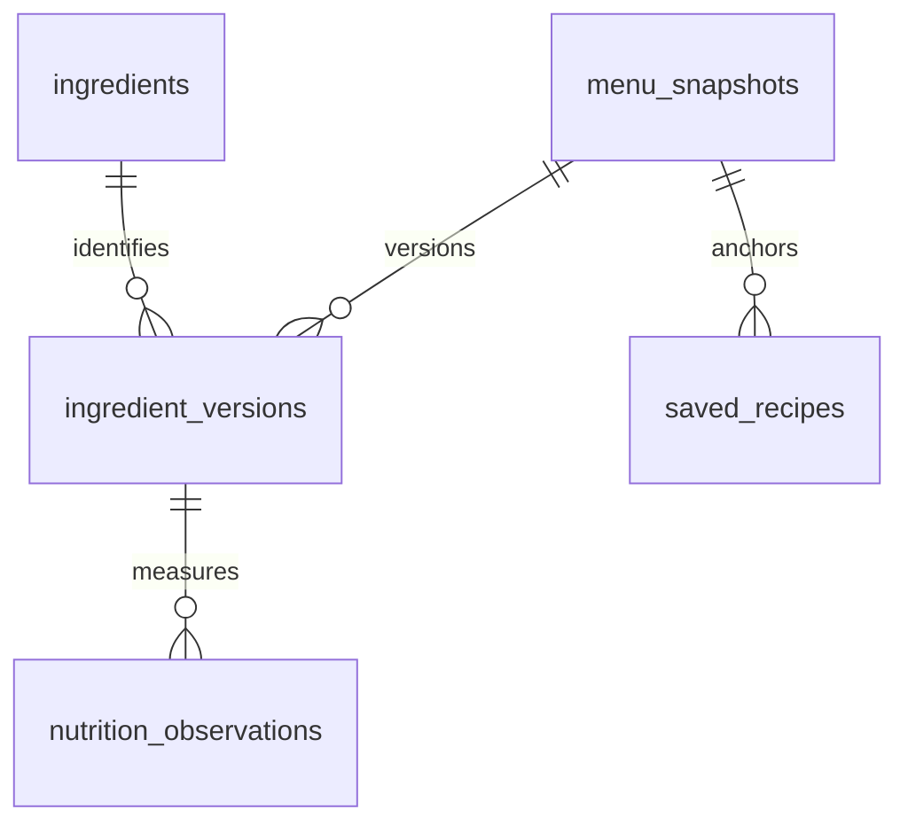

# 面向美国用户验证的技术方案

决策日期：2026-11-11。约束：公开验证产品、固定基础设施费用尽量为零、优先手机体验。

## 先做 Web / PWA

第一版采用响应式 Web，支持主屏幕安装和离线打开已缓存的搭配器。用户点分享链接即可试用，避免 App Store 审核与安装成本。动画使用 React + SVG + CSS，支持减少动态效果偏好，不引入 Three.js。只有验证出持续使用、明确需要推送／系统能力后，才考虑 Capacitor 封装或 Expo 原生 App。先统一配料与营养数据模型，日后可以复用。

## 技术选型

| 层 | 第一版选择 | 选择原因与边界 |
| --- | --- | --- |
| 前端 | React 18 + TypeScript + Vite | 搭配器主要是客户端交互；构建轻量。新搭配器与营养逻辑使用严格类型，旧页面逐步迁移。 |
| 动画 | SVG / CSS | 分层饮料、倒入、冰块和泡沫动画；不需要 3D 或持续 JS 渲染循环。 |
| 前端托管 | Cloudflare Pages | 静态文件从 CDN 分发，适合免费验证。Pages Functions 留给轻量 API。 |
| 数据库 | Supabase 托管的 PostgreSQL | 配料、杯型、份量、营养来源有明确关系；PostgreSQL 约束、事务和版本记录适合这类数据。登录、收藏需要时再启用 Supabase Auth 与 RLS。 |
| 菜单刷新 | Python 标准库脚本 + GitHub Actions | 定时抓取官方公开数据、校验、生成快照，通过 PR 审核后发布。无需常驻服务器。 |
| AI | 可选的单次结构化输出，下一阶段迁至 Pages Function | 核心计算器不依赖模型；旧 Flask / CrewAI 后端保留兼容，不作为免费上线必需项。AI 只提建议，不提供可信热量。 |
| 测试 | Vitest + Testing Library；Python unittest；Playwright 验收 | 热量单位、未知值、输入与错误恢复，以及移动端页面实际验收。 |
| 搜索与分析 | 先不增加数据库服务 | 配料数量小，客户端搜索足够。先统计搭配开始、完成、复制和预设使用；不上传自由输入或精确个人健康信息。 |

第一版不需要 Redis、向量数据库、Kubernetes、独立长期运行的 AI worker。Supabase 也不是运行搭配器的必要依赖：公开配料快照随站点构建发布，浏览器本地保存最近配方。这样数据库暂停时，用户仍可以完成搭配。

## 数据怎么取，热量怎么算

2026-11-11 实测，美国官网的公开 GET 路径能返回菜单与产品详情：

- 菜单：`https://www.starbucks.com/apiproxy/v1/ordering/menu`
- 产品示例：`https://www.starbucks.com/apiproxy/v1/ordering/2121255/iced`

这是官网内部使用的公开响应，不是向开发者承诺稳定的 API。抓取频率控制在每日一次，保留最后成功快照；接口改变时阻止发布。不要绕过鉴权、反爬或门店限制。全局菜单的可选项不代表每家店有货；当前版本不声称已经获取门店库存。

当前快照含 26 种冷热饮品和 165 个自定义选项。基础饮品按杯型保存官方热量、糖与咖啡因；新品 syrups / cold foams 能进入选项列表。**选项名称不是完整配料表，也不包含单份营养。** 基础饮品的配料声明原样展示，添加物的完整成分未验证时明确标为缺失。

官网的自定义营养计算调用本次返回 503，不能作为可靠依赖。当前实现把数据分为：

1. 官方：基础饮品按指定杯型的营养信息，附产品链接和抓取日期。
2. 估算：少量糖浆与奶的显式计算假设，保存在 `shop/src/data/nutrition.ts`，所有结果带 `~`。假设不是 Starbucks 添加物官方标签，不能据此标注“官方低卡”。
3. 未知：没有可靠单份热量的数据。总计显示 `已知值 + ?`，不把未知当成零，也不显示完整低卡结论。

糖浆区分 full / half pump；当前计算明确限定 full pump。奶的用户选项使用官方 splash 档位，内部体积仅用于估算。Foam 按 light / regular / extra 保存选择，但没有经过验证的份量数值时不推算。Protein Foam 名称里有蛋白字样也不会自动生成宏量营养。

后续要补齐热量，优先获取可追溯的官方单份标签或官方计算响应，并记录地区、份量、杯型、来源、验证日期。模型生成值只能是建议，不能写入官方营养表。

## 数据库模型

可执行的 Supabase 初始迁移位于 `supabase/migrations/202611110001_catalog.sql`，尚未对任何云数据库执行。

原始响应保存在 snapshot；配料身份与配方版本分开；营养记录带份量、单位与 evidence_kind。收藏引用使用时的快照，避免更新后旧配方悄悄变化。所有表启用 RLS；公开用户只能读已发布目录，用户只管理自己的收藏。服务端导入凭据绝不放在前端环境变量。

## 成本与部署

核对日期为 2026-11-11，服务商可调整额度。链接是最终依据：

- [Cloudflare Pages 限额](https://developers.cloudflare.com/pages/platform/limits/)：静态部署适合先行上线；自定义域名注册费另计，可先用 `pages.dev`。超额前评估构建次数、文件限制和 Function 用量。
- [Cloudflare Workers 计费](https://developers.cloudflare.com/workers/platform/pricing/)：免费动态请求额度为每日 100,000、每次 10 ms CPU。等待外部网络与 CPU 时间不同，但仍需实测 Function 资源限制。付费计划起步为每月 $5。
- [Supabase 计费](https://supabase.com/pricing)：免费数据库 500 MB、50,000 MAU、1 GB 文件存储，含出站流量限额；免费项目一周不活跃会暂停。生产 SLA、备份和更高额度需另行评估。Pro 当前起步 $25/月。
- [Vercel Hobby 使用范围](https://vercel.com/docs/plans/hobby)：仅限个人非商业用途，因此不选为这个潜在商业产品的默认免费托管。以后需要 Next.js 服务端渲染且预算允许时可以重新评估。

**固定平台费用目标为 $0，不代表 AI 免费。** 第一版基础搭配、动画与低卡预设不需要 OpenAI。开启公网 AI 前再完成服务端密钥、Turnstile、每用户／每日限额和全局调用预算，避免公开付费模型代理；不要为了先上线而裸露调用接口。

## 本轮验收证据

生产构建已完成 TypeScript 检查与 Vite 打包，生成 PWA service worker。42 个前端回归测试、13 个 Python API／菜单测试通过。Playwright 在 390 px 手机宽度和桌面宽度验证热量份量、未知 cold foam、本地保存／恢复、页面路由和离线搭配；没有页面异常或横向溢出。

SVG 动画在当前 Cloud Chromium、4 倍 CPU 节流下抽样 90 帧，帧间隔中位数约 16.7 ms、P95 约 18.7 ms；这不是实体手机性能保证。系统设置减少动态效果时动画关闭。

## 上线顺序与验收

1. 本分支：验证搭配器、动画、来源标注、预设、保存／复制；替换 CRA 为 Vite，部署产物 `shop/dist`。
2. 连接 Cloudflare Git 仓库，配置根目录 `shop`、命令 `npm ci && npm run build`、产物 `dist`，先使用预览地址。无需 Supabase 或 AI 密钥即可验收核心功能。
3. 验证数据快照刷新工作流可在仓库里创建 PR；如 GitHub 设置不允许工作流开 PR，先手动运行脚本并提交。通过测试后再合并和触发站点构建。
4. 有用户需要跨设备收藏时，再创建 Supabase 项目、执行迁移、接入登录；目前浏览器保存不是云收藏。
5. 验证 AI 推荐是否带来留存，再完成 Pages Function 的单次结构化调用与限额。旧 CrewAI 服务不要求为它购买常驻主机。
6. 收集有效使用与反馈后决定商业化、数据库付费与是否开发原生 App。

尚未执行：创建云账号、绑定域名、生产数据库迁移、部署或真实付费 AI 调用。这些需要账户连接／服务配置；本分支不会假称已上线。

## Cold foam 与 Starbucks App 交接补充（2026-11-11）

已查询 Chocolate Cream Cold Brew、Salted Caramel Cream Cold Brew，以及 Cold Brew with Nondairy Vanilla Sweet Cream Cold Foam 的官方默认配方。Grande 分别为 240、240、160 kcal，均含 2 泵香草糖浆，不能把它们与黑冷萃之差直接算成 foam 本身的热量。

同步脚本现保留这三款、四个杯型共 12 个标准配方的完整默认 modifier 身份、数量、份量和营养。只有搭配完全匹配时才采用整杯官方营养；改糖浆数量、换奶、改泡沫份量后自动回到估算／未知状态。单独 foam 的热量仍不假称已验证，整杯营养与各组件参考值分开展示。

下单按钮打开匹配的官方标准饮品页，否则打开所选基底页。Starbucks 的 [iOS Universal Links 配置](https://www.starbucks.com/.well-known/apple-app-site-association) 注册了 `/menu/product/*/*`；设备可能将产品链接交给 App，但本项目未在实体 iPhone／Android 上验证唤起，也不会声称已导入自定义项。

[官方 Secret Menu](https://about.starbucks.com/stories/2025/introducing-the-secret-menu-in-the-starbucks-app/) 与 [官方 ChatGPT 集成](https://about.starbucks.com/stories/2026/meet-the-beta-starbucks-app-in-chatgpt-a-new-way-to-discover-your-next-favorite-drink/) 有带自定义项的交接能力；本次未找到供独立第三方任意导入配方的公开协议或 API 文档。目前 Copy order 仍是文字参考，用户在 Starbucks 中自行选择自定义项并确认。

## 全目录估算模型补充（2026-11-11）

用户明确要求估算全部配料后，新增 `ingredient-estimates.ts`：当前 138 个选项中，123 个食品／水冰条目建立估算，15 个准备设置不作为额外食物计算。配料库可搜索、分类、查看假设与导出 CSV。原始官方快照中的单项 calories 仍保持 null；模型值另存，避免把估算污染成官方标签。

估算使用三类方法：同类食品假设、官方完整配方减去已知基底与估算糖浆的残差，以及水／冰的零能量。糖浆为约 10 mL full pump；奶按 100 mL；粉末、酱、淋酱等给出明确假设重量。三款已知 foam 用各杯型完整配方计算残差；其他 foam 使用 Grande 同类模型和 Tall×0.8、Venti×1.2、Trenta×1.4 的假设。Light×0.65、extra×1.5 也是模型假设，不是咖啡师标准配方或官方份量。

整杯显示中心估算与各项上下界相加的情景范围。范围不是经测量验证的误差界限或统计置信区间，模型置信度标为 low。完全匹配官方标准配方时总热量仍采用官方值；不把拆分的各项估算相加去覆盖它。尚未验证的蛋白质、糖和完整成分不会因有热量估算而自动补全。

参考包括 [FDA 的能量系数方法](https://www.fda.gov/media/81606/download)、[英国 Starbucks 营养与配料表](https://www.starbucks.co.uk/sites/starbucks-uk-pwa/files/2026-04/SUM26_UK_AllergenBook_CORE_BEVERAGE_v02.pdf)、[通用奶制品参考](https://www.darigold.com/product/2-reduced-fat-milk/)、[通用鲜奶油食谱](https://www.landolakes.com/recipe/9419/sweetened-whipped-cream/)。跨地区和零售食材仅作同类参照，不宣称是美国 Starbucks 门店的单项标签。未来未识别的食品组会保持“无模型”，目录覆盖检查会阻止无声发布。

## 扩展自定义选项（2026-11-11）

搭配器新增 More flavors & toppings：按官方快照的基底兼容性提供酱料、额外糖浆、甜味剂、淋酱、杯壁酱、粉末、toppings、鲜奶油、espresso shots，以及绿茶可用的果料、果汁、茶与 Refresher concentrate。冷萃有 47 个可选添加物，绿茶有 32 个；不是把所有配料无条件开放给所有基底。主要糖浆选中后会从额外列表去重，因此已选主糖浆时额外选项数会相应减少。

`extras` 可选字段保留旧配方的读取兼容性。每种添加物的数量、假设单位、范围和方法参与整杯估算与 order text，也随保存／恢复保留。切换基底会移除不兼容项；主糖浆变化会去掉重复添加项。额外 espresso 使用整 shot，甜味包使用整包，其余支持半份模型。主要糖浆和额外糖浆均改为整泵；其他假设份量不等同于糖浆泵数。

新增 espresso 的烘焙与萃取选项仅在快照支持、且已添加 espresso 时显示；这里的选项针对额外 espresso，不冒充更换 cold brew 的咖啡豆。添加物含咖啡因时缺乏完整营养数据，因此存在额外添加物的整杯咖啡因保守显示未知。添加任何非零额外配料都会取消完整官方配方匹配。

动画新增酱料层、额外糖浆、espresso 深色层、奶油、淋酱、topping 与果料；保持示意而非实际体积／物理模拟。

## 配料选择交互简化（2026-11-11）

根据用户反馈，移除“选分类 → 选配料 → 点 Add”的串行流程。额外配料改成始终可见的搜索入口、分类标签和就地 −／＋；常用入口只作为 Quick picks，不宣称是基于用户统计的热门排行。搜索跨类别，输入后自动切回 All；分类与搜索二选一即可找到配料。已选项目固定高度横向汇总，直接移除；计数器预留固定宽度，首次加入不挤压配料名或移动加号位置。选中 espresso 后，烘焙／萃取收纳到可选设置。

自动化验证覆盖单击添加、就地调整、跨分类搜索、直接移除、空搜索恢复、手机无横向溢出，以及键盘 Enter 加入后保留焦点继续调整。更换基底会重置筛选界面，但依照兼容性保留可用的已选配料。营养、来源、份量假设和保存格式不变。

## 手机操作优化（2026-11-11）

650 px 及以下使用原生 dialog 底部配料弹层，桌面保留内联列表。弹层支持背景滚动锁定、关闭／Escape、返回原触发点，并随 visualViewport 高度变化调整可用高度。输入字号为 16 px，配料 −／＋触控尺寸为 44×44；使用系统减少动态效果偏好。

页面底部固定显示整杯热量、Add extras 与 View recipe；弹层底部另有热量和 Done。配方入口移动焦点并滚动到配方，保留底部安全区域空间。验证覆盖 390×844、390×500 和 320×568 的浏览器视口、弹层开关、滚动锁恢复、触控尺寸与配方定位。尚未宣称经过实体 iPhone／Android 软键盘、刘海屏或系统手势验收。

## 严格类别与整泵糖浆（2026-11-11）

根据用户反馈，自定义分类改为对应官方配料组：Toppings、Drizzle、Sauces、Powders、Line the cup、Whipped cream、Syrups 等各自独立，水果／果汁／茶等也不再并成一个大类。搜索仍可跨类，但类别标签不会混入其他组。Cold foam 单独展示，并区分普通、Nondairy、Protein；浏览其他 foam 类别不移除当前选择，只有实际选新口味才替换。

主糖浆、额外糖浆与液体甜味剂均采用官方配置的 0–12 整数数量，移除 0.5 步长。旧收藏含小数糖浆时，在加载副本中四舍五入并明确提示检查；不自动覆盖旧收藏，复核后由用户保存。份量模型保持有出处的估算说明，其他配料的半份不称为半泵糖浆。

### Official ordering controls (2026-11-11)

User requirement: all design decisions should reference Starbucks US App ordering settings. The official ordering frontend and product metadata provide auditable category, quantity, and portion rules; native App pixel-level parity has not been verified. Preserve separate syrup/sauce/topping/drizzle/foam groups. `formCode=qty` uses whole counts; `modifier` uses only source-supported Light/Regular/Extra; `one` permits one selection per group. The maximum modifier count is read from official menu bootstrap config and validated before snapshot publication.

Milk choices use official 1/4 Inch Splash, 1/2 Inch Splash, and 3/4 Inch Splash labels. Internal volume scenarios are 15–45, 30–90, and 45–135 mL, with central assumptions 30/60/90 mL; these are not Starbucks published pour volumes. Legacy saved mL choices migrate to splash choices with a review notice. Modifier quantity factors are also explicitly internal estimates. Copied orders show official choice labels instead of assumed weights.

The fixed cup viewport contains geometry scaled by selected size (US iced Tall 12, Grande 16, Venti 24, Trenta 30 fl oz), keeping the surrounding calorie layout stable. Browser checks assert monotonically increasing cup bounds. Validation: 48 frontend tests, 14 backend/sync tests, production build, and desktop/mobile browser workflows, including splash labels, integer counts, modifier portions, saved recipes, and actual cup size changes.

### Classic drink starters and saved orders

The 26 US starters store real product/form IDs, size capacities, source labels, and per-size default builds. Selecting a drink replaces the previous recipe with its standard settings. A size change adjusts only untouched defaults. Milk Options is a replacement for recipe milk; Creamer remains a splash added to black coffee. Hot Venti uses 20 fl oz and iced Venti 24 fl oz; hot drinks and Nitro show no ice.

Nutrition starts with the official full-drink calories and applies estimated deltas for additions, reductions, removal, and milk substitutions. Default milk/sauce/shots/whip are never added on top of the full-drink label. Milk substitution scenarios use explicitly internal volume assumptions (cup capacity × 0.55 iced, 0.8 hot, with family exceptions), not Starbucks measured pours. Removed ingredient scenario ranges reverse their endpoints; total energy is clamped at zero. Changed recipes retain estimate/unknown labels. Recipe schema version 2 stores total shot counts; legacy saved Americano extra shots migrate exactly once to total shots.

Saved orders support names, multiple recipes, reload, and removal in browser localStorage. They are device-local and do not write to Starbucks accounts. The official link is labeled Open Starbucks menu with an explicit explanation; no supported third-party recipe-import / favorite-write integration has been identified. Existing audience remains owner-private.

Validation for classic starters: 54 frontend tests, 14 backend/snapshot tests, strict production build, and authenticated production browser workflows. The browser harness uses TLS-verified HTTP responses with the environment CA for the owner-private Site and does not send the service credential to external origins. Authentication redirects are not exercised by that harness. Offline checks are excluded for service-authenticated runs; existing local offline coverage is retained. The 320px ingredient-group filter overflow was reproduced and fixed by constraining its flex label width.

### 3D drink preview

The drink preview now lazy-loads a Three.js scene with a tapered open cup, separate paper/hot and transparent/cold materials, a textured hot sleeve, irregular rounded ice, foam surface microtexture, piped whipped cream, three-dimensional drizzle/lining and toppings. The camera remains fixed across ingredient changes and scales the cup by the sourced size profile. Milk uses a procedural animated density field with descending plumes and gradual mixing; this is a visual approximation, not a fluid or nutrition simulator. Syrup is delivered in discrete integer pulses without changing the camera frame. Pointer drag rotates the cup, and the existing opt-in shake gesture still mixes it.

Rendering runs on demand, pauses outside the viewport/in hidden documents, caps pixel ratio and frame rate on small viewports, and stops once an action settles. Reduced-motion preference changes apply immediately. Context loss or unavailable WebGL falls back to the accessible SVG view. The 3D chunk is loaded separately; the builder can load without waiting for it. On phones the cup remains visible during customization, with Enlarge cup / Compact cup controls. Focusing the order releases the sticky preview to keep the receipt readable.

Visual checks are in scripts/visual_browser.py (owner-private service token is accepted via hidden stdin only): actual WebGL startup, milk/pour/foam/mixing captures, strictly increasing projected cup size, hot cup without ice, idle render suspension, reduced-motion changes, and 320/390px layouts. The service credential is sent only to the existing Site origin over TLS verified with the environment CA. Browser software rendering and viewport emulation do not establish performance on every physical handset.

Final animation validation: 54 frontend tests and the production build pass. Authenticated WebGL visual checks and the full ordering browser regression pass without page errors. The mobile preview releases its sticky position when the order region enters the viewport, including 320px layouts, so saved-order controls remain clickable.

### Syrup bottle regression and material correction

Restored the selected-flavor bottle in the WebGL renderer after the renderer migration had dropped it. The bottle stays visible while syrup is selected; the pump handle, spout and syrup stream animate together. Both the SVG fallback and WebGL scene use the shared `syrup-pulses.ts` plan: added whole pumps animate, reductions do not replay, flavor changes update the label, and Replay includes the full selection. Rapid increases append pending doses instead of cancelling the previous press. The fixed camera does not zoom when a bottle appears.

The prior ice geometry distortion and transparent triangle overdraw produced folded-plastic shapes. Ice now retains the rounded-box normals and writes depth for its translucent faces; it avoids an expensive transmission pass that made the preview miss short pump actions on slow rendering. Milk plumes are temporary; prepared recipes and settled pours use a warm perceptual color blend referenced to the official US Cold Brew and Iced Caffe Latte photographs (`cloudassets.starbucks.com/is/image/sbuxcorp/ColdBrew` and `/IcedCaffeLatte`), instead of leaving gray procedural noise as the final appearance. These remain illustrative renderings.

Pump timing uses a bounded presentation clock so a slow frame cannot skip the entire downstroke. Cold material compilation completes before action clocks begin; queued increases append doses. Visual regression captures cover Vanilla/Hazelnut bottle identity, two added pumps, three-pump Replay, and bottle removal. The complete pump remains inside the fixed frame.

### Recovering stale menus and update behavior

The old service worker precached `index.html` and used it for every app navigation. This could leave a tab showing the 123-entry menu without the 26 classic drink starters after publication. `/api/refresh` (the static `api/refresh.html` page) is outside that legacy navigation fallback. It unregisters this origin's workers and removes only Workbox/app-page caches, then opens the current builder. It leaves localStorage, sessionStorage, cookies and IndexedDB untouched.

Current workers use NetworkFirst for app document navigation, bypass HTTP caches for worker checks, and do not precache HTML. A waiting release offers an explicit Update now action. A session draft preserves the current recipe and order name through reloads; named saved orders remain in localStorage. Static `.html` entries generated by `shop/scripts/static-routes.mjs` let the current builder and bundled menu routes load directly without depending on a previously installed worker. Additional database-only detail routes would need matching static entries or a server fallback before using this hosting mode.

Validation: 59 frontend tests and the strict production build pass. The release artifacts contain matching direct-route entries and no precached HTML. `scripts/update_browser.py` passed against release source `7764afc9ecfee5a2a82eaf9dbc2111ed18deee9e`: a test-only legacy worker reproduced the old navigation shell, the actual hosted `/api/refresh` bypassed it, and all 26 starters returned. Named saved orders, the last recipe and the session draft were preserved exactly; a subsequent reload retained the customized Latte. The 390px layout had no horizontal overflow and the Vanilla syrup bottle remained visible. No page errors occurred. The harness uses TLS-verified HTTP responses without changing browser trust settings; it does not establish offline installation of the production worker or performance on physical phones.

### Ice volume and waterline

Ice uses separate rounded solids distributed across the cup, with one piece lower in the drink. The liquid backdrop no longer writes depth that would cut off every submerged face. Ice retains depth testing/writing and opaque foam still occludes it; a waterline tint and view-angle opacity distinguish submerged ice from exposed rounded edges. This is an inexpensive visual approximation, with no screen-space transmission pass. Oriented-box and vertex checks cover separation, tapered-wall clearance, and limited protrusion for all four iced sizes at three foam depths. Desktop/mobile WebGL captures cover Latte, Cold Brew, Matcha and the hot-drink case with no ice.
